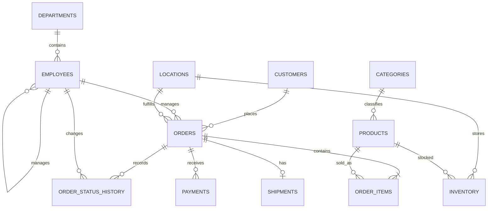

# Entity Relationship Diagram

The schema uses `order_items` as the associative/detail relation between orders and products, while `inventory` resolves the many-to-many relationship between locations and products.
